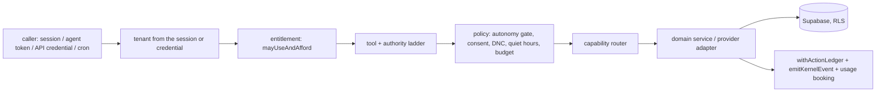
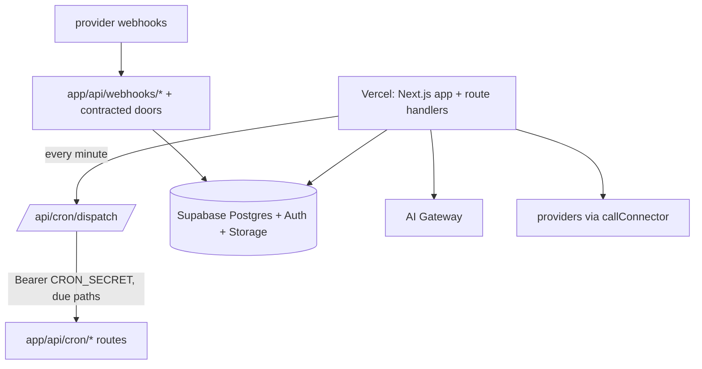

# Production architecture (wave 138, lane 138F)

This is the shipped system as it stands at base `2fc959f0c`, written for the production release. The laws it runs under are in `docs/architecture/OS-CONSTITUTION.md`, which stays the survivor for laws and principles. This page holds the deployed shape, the extension and self-healing models, the security and evidence rails, and the runbook.

Every claim cites `file:line`. `npm run test:production-readiness` (`scripts/production-readiness-guard.ts`) fails if a cited file or line stops existing, or if the env table, the RLS backstop or the heap numbers below disagree with the code.

## 1. The seven layers mapped to modules

These are the owner's seven layers (wave 100 ruling). Each row names the survivor module that implements the layer.

| # | Layer | Survivor (entry point) |
|---|---|---|
| 1 | SaaS control plane | Access and entitlement: `mayUseAndAfford` `lib/billing/billing-access.ts:313` (a missing subscription row fails closed: `lib/billing/billing-access.ts:79`). Tenant policy versions: `appendTenantPolicyVersion` `lib/kernel/tenant-policy.ts:323`. Impersonation: `lib/platform/impersonation.ts:63`. Go-live readiness: `runGoLiveReadiness` `lib/platform/go-live-readiness.ts:46`. |
| 2 | Agentic kernel | The 14 managers: `MANAGERS` `lib/kernel/manager-registry.ts:82`, with ownership maps `MAINTENANCE_DOMAINS` (`:599`), `TABLE_MANAGER` (`:1832`) and `CRON_MANAGER` (`:2768`). Events: `emitKernelEvent` `lib/kernel/emit.ts:154` and `KernelEvent` `lib/kernel/events.ts:17`, reacted to by `dispatchKernelEvent` `lib/kernel/event-reactor.ts:95`. Evidence: `withActionLedger` `lib/kernel/action-ledger.ts:532`. Missions: `createMission` `lib/kernel/missions.ts:460`. |
| 3 | Real-estate intelligence graph | Person identity: `resolvePerson` `lib/kernel/person-identity.ts:181`. Relationships: `upsertRelationship` `lib/kernel/relationship-graph.ts:245`. Memory: `loadContactMemoryForPrompt` `lib/kernel/conversation-memory.ts:633`. Context compiler: `compileManagerContext` `lib/kernel/mission-context.ts:291`. |
| 4 | Capability / provider fabric | Route table: `CONTACT_PROVIDER_ROUTES` `lib/ai-isa/property-lookup-rail.ts:314`. Router: `routeCapability` (`:385`). AVM: `requestPropertyValuation` `lib/avm/provider-chain.ts:299`. One egress: `callConnector` `lib/agentic-os/connector-gateway.ts:218`, with health from `deriveProviderHealth` (`:394`). Adapters: `deriveProviderAdapters` `lib/kernel/provider-adapters.ts:177`. Registry: `CONNECTOR_REGISTRY` `lib/agentic-os/connector-registry.ts:68`. |
| 5 | Education / competency | `COMPETENCY_SKILLS` `lib/education/skill-freshness.ts:130`. |
| 6 | Performance / economic | `loadEconomicGraph` `lib/kernel/economic-graph.ts:504`. Attribution: `loadLedgerAttribution` `lib/intelligence/roi-ledger.ts:323`. |
| 7 | Learning / digital twin / mission | Twin: `buildBrokerageTwin` `lib/kernel/brokerage-twin.ts:1596`. Learning classes: `OPTIMIZATION_CLASSES` `lib/kernel/self-optimization.ts:46`. Strategies: `lib/kernel/strategy-library.ts:39`. Budget envelopes: `AUTONOMY_ENVELOPES` `lib/kernel/autonomy-budgets.ts:42`. |

## 2. The kernel request path

Every consequential request takes the LAW 4 chain. The diagram shows that chain.

1. **Edge.** `proxy.ts:150` lets `classifyProxyPath` (`app/constants/auth.ts:271`) decide whether a request is public, protected or open. Public-by-name routes are listed at `app/constants/auth.ts:88`, and sessionless provider doors at `app/constants/auth.ts:69`. A protected path without a session is redirected (`proxy.ts:164`).
2. **Tenant.** The tenant comes from the session (`requireCallerTenant` `lib/auth/require-caller.ts:381`; writes go through `resolveWriteContextForTenant` `lib/platform/acting-context.ts:326`). An API caller's tenant comes from its credential (`resolveAgenticCaller` `lib/agentic-os/agent-credentials.ts:80`; `serveDomainApi` `lib/kernel/domain-api.ts:154`, mounted at `app/api/v1/[resource]/route.ts:7`).
3. **Entitlement.** `mayUseAndAfford` `lib/billing/billing-access.ts:313`. Usage caps: `checkUsageCap` `lib/usage/check-cap.ts:49`.
4. **Tool and authority.** Tools are chosen by persona (`selectToolsForPersona` `lib/ai-isa/persona-tool-policy.ts:595`) and classed by risk (`riskClassForTool` `lib/ai-isa/persona-tool-policy.ts:756`). The authority level comes from `resolveAgentAuthorityLevel` `lib/managers/autonomy-gate.ts:298`.
5. **Policy.** `autonomyDecision` `lib/managers/autonomy-gate.ts:91`, then the send gates in `lib/providers/dispatch.ts:492`.
6. **Capability.** `routeCapability` `lib/ai-isa/property-lookup-rail.ts:385`, then `callConnector` `lib/agentic-os/connector-gateway.ts:218`.
7. **Evidence and cost.** `withActionLedger` `lib/kernel/action-ledger.ts:532`, `emitKernelEvent` `lib/kernel/emit.ts:154`, `logAIUsage` `lib/ai/cost-tracking.ts:154`, `meterVendorSpend` `lib/vendor-governance/meter-vendor.ts:46`.

No LLM reaches SQL directly. The model proposes, and the domain services above enforce (`docs/architecture/OS-CONSTITUTION.md:49`).

## 3. Extension model (one lifecycle, governed contracts)

| Extension | Contract / survivor | Governance |
|---|---|---|
| Domain API | `serveDomainApi` `lib/kernel/domain-api.ts:154` | Tenant from the credential, a per-credential rate limit, scopes, `mayUseAndAfford`, and an evidence row. |
| Outbound webhooks | `postSignedWebhook` `lib/platform/tenant-webhooks.ts:79`, `enqueueTenantWebhookDeliveries` (`:147`), `drainTenantWebhookDeliveries` (`:516`) | HMAC-signed, with rotation overlap and a backoff ladder. Drained by the `/api/cron/webhook-deliveries` cron. |
| Inbound webhooks | `WEBHOOK_CONTRACT` `lib/providers/webhook-contract.ts:101` | Every door is signature- or secret-verified (census W in the readiness guard; scheme truth in `test:webhook-contract`). |
| Provider adapters | `deriveProviderAdapters` `lib/kernel/provider-adapters.ts:177`, `adapterFor` (`:193`) | Reached only through the router and the gateway (LAW 3). |
| Skills | `lib/kernel/skill-registry.ts:47`, marketplace `submitSkillListing` `lib/kernel/skill-marketplace.ts:236` → `evaluateSkillListing` (`:274`) → `decideSkillListing` (`:296`) → `setTenantExtensionEnabled` (`:340`) | One lifecycle: submit, evaluate, decide, then enable per tenant. |
| Custom managers | `MANAGERS` `lib/kernel/manager-registry.ts:82` | No new managers are added to prove anything (wave 137 ruling). |

## 4. Self-healing model — what heals itself vs what goes to a human

`decideRecovery` `lib/kernel/os-health.ts:160` is the single decision point for recovery. It runs over the classes in `INCIDENT_CLASSES` (`lib/kernel/os-health.ts:54`), which the detectors in `HEALTH_DETECTORS` (`lib/kernel/os-health.ts:61`) feed. The supervisor is `runOsHealthSupervisor` `lib/kernel/os-health.ts:909`, ticked from the reaper net (`lib/intelligence/reaper-net.ts:242`).

| Heals itself | Goes to a human (or its accountable manager) |
|---|---|
| A transient failure on an idempotent action is retried up to the cap (`lib/kernel/os-health.ts:183`). | **Money**: the writer is halted and Finance reviews. The OS never corrects money (`lib/kernel/os-health.ts:164`). |
| A rate limit gets exponential backoff (`lib/kernel/os-health.ts:191`). | **Compliance** findings go to the Compliance Officer (`lib/kernel/os-health.ts:175`). |
| A failing provider fails over through `routeCapability` (`lib/kernel/os-health.ts:196`). Provider repair runs through `healProviderFailure` `lib/agentic-os/connector-healer.ts:257` from the connector-health cron (`app/api/cron/connector-health/route.ts:300`). Config-level alternates are auto-applied (`applyDeclaredAlternate` `lib/agentic-os/connector-auto-applier.ts:47`). Code-level fixes become proposals (`proposeConnectorHealing` `lib/agentic-os/connector-healer.ts:59`). | **Data conflicts** go to the Data Steward and are never overwritten (`lib/kernel/os-health.ts:177`). |
| A stuck workflow whose next step never started is resumed (`lib/kernel/os-health.ts:201`). | **Unknown**, **non-idempotent** or **over-the-cap** cases go to a human (`lib/kernel/os-health.ts:179`). Per the wave 138 ruling, anything that crosses tenants or is a security breach always goes to a human. |

## 5. Security and tenancy boundaries

- **Tenant from the session, fail closed.** See `lib/auth/require-caller.ts:381` and CLAUDE.md §4. The tenant-admin roster is defined at `lib/auth/resolve-user-role.ts:286`.
- **The service client is used only after a gate.** `createServiceClient` `lib/supabase/service.ts:4` throws when its env is unset. Readiness census S publishes every `"use server"` export that reaches the service client before a gate-shaped call; wave 139 (139G) closed five that took the tenant or the actor from the request body: `app/actions/portal-document-requests.ts`, `app/actions/portal-loan-checklist.ts`, `app/actions/education-tutor.ts` (all three now `requireContactAccess` `lib/portal/require-contact-access.ts:114`), `app/actions/compliance/seed-required-docs.ts` (the one required-docs authority in `app/actions/compliance/manage-required-docs.ts`) and `app/actions/buyer-offer/record-seller-signed-counter.ts` (`requireCaller` `lib/auth/require-caller.ts:161`).
- **RLS.** Live census (read-only, 2026-10-07, project `hrvaqgvukzxfskkcrwbt`): 767 public base tables, 767 with RLS enabled, 0 without. 56 of those tables have RLS and no policy, so `anon` and `authenticated` are denied and only the service role can reach them. The live backstop is the `ensure_rls` event trigger (`ddl_command_end` → `public.rls_auto_enable()`), which enables RLS on every new `public` table. That trigger lives **only in the live database and no repository file creates it** (see the runbook: a rebuilt environment must turn it back on). Policy-shape guards: `test:rls-public-grant`, `test:rls-anon-escape`.
- **Webhooks** are verified per `lib/providers/webhook-contract.ts:101`. There are 33 contracted doors and none is unverified (readiness census W). No contracted webhook module calls `timingSafeEqual` without a length guard (census W4): unequal lengths throw, which answered a forged signature 500 instead of 401.
- **Public writes.** Every writer route the proxy does not session-gate is gated, throttled with `checkPublicRateLimit` `lib/security/public-rate-limit.ts:61`, or classified with a reason (census P). The limiter keeps its counters per instance (`lib/security/public-rate-limit.ts:9`). A distributed limiter is wave-138D work.
- **Client bundles.** No secret-shaped `NEXT_PUBLIC_*` name exists outside the classified public keys, and no `"use client"` module reads a server env var (census N). Demo sign-in is hard-gated off in production (`app/constants/auth.ts:284`).
- **Secrets at rest** use AES-256-GCM envelopes (`encryptSecret` `lib/security/secret-crypto.ts:43`, `decryptSecret` `lib/security/secret-crypto.ts:57`). The rotation monitor is `loadRotationRisks` `lib/security/credential-rotation.ts:73`.

## 6. Data, evidence, cost and usage rails

| Rail | Survivor |
|---|---|
| Action evidence | `withActionLedger` `lib/kernel/action-ledger.ts:532` (`agent_action_ledger`) |
| Events and causation | `emitKernelEvent` `lib/kernel/emit.ts:154` |
| AI cost (this is the invoice) | `logAIUsage` `lib/ai/cost-tracking.ts:154` (`ai_tool_usage`). Model routing: `AI_TASK_ROUTING` `lib/ai/models.ts:118`. |
| Vendor spend | `meterVendorSpend` `lib/vendor-governance/meter-vendor.ts:46` |
| Usage caps | `checkUsageCap` `lib/usage/check-cap.ts:49` |
| Outcome attribution | `loadLedgerAttribution` `lib/intelligence/roi-ledger.ts:323` |
| Errors | `collectError` `lib/errors/collect-error.ts:115` (`automation_errors`). Root UI boundary: `app/error.tsx:30`. |
| Schema truth | Generated caches, never hand-edited (CLAUDE.md §3). Drift is checked by `scripts/schema-cache-drift-guard.ts`. |

## 7. The built-in assistant team

The assistant reaches managers and skills only through governed paths:

- The starter assistant is seeded per tenant (`seedStarterAssistant` `lib/kernel/assistant-starter.ts:26`).
- The staff copilot is `app/api/internal/ai-chat/route.ts:362`. Its tools are persona-selected (`lib/ai-isa/persona-tool-policy.ts:595`).
- Voice commands go through `buildVoicePlan` `lib/voice-admin/kernel-command-surface.ts:261`, over `APP_CAPABILITY_REGISTRY` `lib/agentic-os/app-capability-registry.ts:128`.
- The exceptions-first surface is `loadCommandCenter` `lib/kernel/command-center.ts:390`.

## 8. Deploy topology

- **One platform cron.** `vercel.json` schedules only `/api/cron/dispatch`, every minute. The dispatcher (`app/api/cron/dispatch/route.ts:17`) gates on `verifyCronAuth` (`app/api/cron/dispatch/route.ts:18`) and fans out to `CRON_REGISTRY` (`lib/kernel/cron-dispatch.ts:27`) via `dispatchDueCrons` (`lib/kernel/cron-dispatch.ts:408`). At base there are 222 registry entries over 210 distinct routes, and every one is owned in `CRON_MANAGER`.
- **Build heap.** `vercel.json` builds with `--max-old-space-size=10240`. CI builds with `BUILD_HEAP_MB` defaulting to 14336 (`.github/workflows/build.yml:522`), and the generate step uses 10240 (`.github/workflows/build.yml:616`). The bracket and the exit-134 behaviour are documented at `.github/workflows/build.yml:58`. Re-run unchanged and escalate after three failures at one commit (CLAUDE.md §8).
- **Heavy functions** (Remotion and ffmpeg renders) get 3008 MB and 300 s in `vercel.json` `functions`.

### Required environment (fail-closed behaviour)

| Variable | Fail-closed behaviour |
|---|---|
| `NEXT_PUBLIC_SUPABASE_URL` | The server client throws when it is unset (`lib/supabase/server.ts:11`). The service client also throws (`lib/supabase/service.ts:8`). |
| `NEXT_PUBLIC_SUPABASE_ANON_KEY` | Read by the browser client (`lib/supabase/client.ts:10`) and the server client. Public by design: every row it can reach is RLS-bound. |
| `SUPABASE_SERVICE_ROLE_KEY` | The service client throws "Missing Supabase service role environment variables" (`lib/supabase/service.ts:8`). |
| `CRON_SECRET` | Unset returns 500 and a wrong or missing credential returns 401 (`lib/cron-auth.ts:44`, `lib/cron-auth.ts:49`). |
| `SECRETS_ENCRYPTION_KEY` | **Required; fail closed** (wave 139E, owner "approve all"). Without it every NEW secret write is refused with the typed `SecretStorageRefusedError` (`encryptSecret`, `lib/security/secret-crypto.ts`), nothing is stored in plaintext, the OAuth refresh and the OAuth callbacks refuse BEFORE the provider exchange, and the platform incident `secret_storage_unconfigured` is raised (`raiseSecretStorageIncident`, `lib/security/credential-rotation.ts`). Decrypting an envelope throws without it. Legacy plaintext rows keep reading and are re-sealed by `migrateLegacyPlaintextSecrets` (`lib/security/secret-migration.ts`) once the key is set. Rotation: `SECRETS_ENCRYPTION_KEY_PREVIOUS` (read-only dual-key). R-2 CLOSED. |
| `INTERNAL_API_SECRET` | Internal intelligence doors refuse 401 when it is unset or wrong (`app/api/intelligence/classify/route.ts:12`). |
| `STRIPE_SECRET_KEY` | `getStripe` throws (`lib/stripe.ts:100`). |
| `AI_GATEWAY_API_KEY` | The model factory throws (`lib/ai/models.ts:46`). |
| `NEXT_PUBLIC_APP_URL` | The canonical origin for links and webhook URLs, read at `proxy.ts:123`. |

Webhook secrets: each env name in `WEBHOOK_CONTRACT.secretEnv` is written in `.env.example` (census E4). The whole-tree parity check is `test:env-var-parity`.

## 9. Operational runbook

**Incident.**
1. Read the OS-health line and the supervisor's incidents (`loadOsHealthLine` `lib/kernel/os-health.ts:1018`).
2. Open the error console (`automation_errors`, written by `lib/errors/collect-error.ts:115`).
3. Check the provider health of the failing capability (`loadProviderHealth` `lib/agentic-os/connector-gateway.ts:444`).
4. Money: a financial writer can be halted per tenant (`haltFinancialWriter` `lib/kernel/os-health.ts:235`). Release the halt only with evidence (`releaseFinancialWriterHalt` `lib/kernel/os-health.ts:262`). Platform staff may release it (wave 137 ruling).
5. Stripe drift is cross-checked by `app/api/cron/stripe-drift/route.ts:34`.

**Rollback.**
- Application: promote the previous Vercel deployment. This changes no data.
- Database: migrations are forward-only. Roll back by writing a new migration that restores the prior shape, applied by the integrator. Never hand-edit a schema cache: regenerate it (`npm run schema:regen`).

**Key rotation.**
- **Webhook signing secrets for tenants** rotate with an overlap pair (`lib/platform/tenant-webhooks.ts:76`).
- **Domain-API credentials** rotate and revoke through the tenant door with ledger evidence (`lib/kernel/domain-api.ts:154`).
- **`CRON_SECRET`.** Set the new value in Vercel and redeploy. The dispatcher and every target read the same variable, so there is no overlap window. Expect one minute of 401s at most.
- **`SUPABASE_SERVICE_ROLE_KEY`.** Roll the key in Supabase, update Vercel, then redeploy.
- **`SECRETS_ENCRYPTION_KEY`.** Dual-key read (wave 139E): set the new key as `SECRETS_ENCRYPTION_KEY` and the old one as `SECRETS_ENCRYPTION_KEY_PREVIOUS`; existing `enc:v1` envelopes keep decrypting (the GCM auth tag tells the keys apart, never a garbled plaintext), new writes seal with the current key only. Re-seal everything under the new key by running the platform-staff "Re-seal legacy plaintext secrets" action (OS Sentinel board) — it only touches plaintext rows; envelopes under the previous key are re-sealed when their owner reconnects or the token refreshes. Remove the previous key once nothing is sealed with it.
- **Provider OAuth expiry** is surfaced by `escalateRotationRisks` `lib/security/credential-rotation.ts:122`.

**Migration application.**
- Lanes only write migrations. The integrator applies them one statement per `execute_sql` call, never in parallel.
- After a CHECK change, regenerate the vocabulary cache (CLAUDE.md §3).
- **Destructive DDL needs the owner's confirmation.** Standalone `DROP INDEX` / `DROP POLICY` goes in its own file and is held for the owner (example: `supabase/migrations/m739-drop-retired-skill-listing-indexes.sql:5`). `ALTER TABLE … DROP CONSTRAINT` inside an ALTER, `ALTER POLICY` and `CREATE OR REPLACE` go through. Never bypass the confirmation with dynamic SQL.

**New environment / disaster recovery.**
- Recreate the `ensure_rls` event trigger. Either enable Supabase's automatic RLS for new tables, or recreate `public.rls_auto_enable()` and the `ddl_command_end` trigger.
- Set every variable in the env table above, plus the webhook secrets in `.env.example`.
- Point every provider console at the paths in `lib/providers/webhook-contract.ts:101`.
- Restrict the Google Maps browser key by HTTP referrer.

## 10. Readiness findings (lane 138F)

See the lane notes for the full list. At this base:

- **Fixed (P1):** six unauthenticated contact-creating intake doors had no throttle. They now call `checkPublicRateLimit`.
- **Open:**
  - **R-1:** the RLS backstop exists only live.
  - **R-2 (CLOSED, wave 139E + 140H):** `encryptSecret` fails closed (typed refusal, incident, never plaintext); dual-key rotation; every credential-store writer encrypts and every reader decrypts (`scripts/credential-migration-guard.ts` census); legacy plaintext rows are re-sealed verify-before-rewrite by `lib/security/secret-migration.ts` (platform-staff action + daily sentinel heartbeat).
  - **R-3:** QuickBooks still pins `minorversion=73`. Intuit serves 75 for any value below 75 as of 2025-08-01.
  - **R-4 (CLOSED, wave 139 / 139G):** `app/api/twiml/whisper-bridge/route.ts` now verifies through the canonical `validateTwilioSignature` `lib/voice/twilio-voice.ts:32` (401, never 500), has its `WEBHOOK_CONTRACT` row, and `app/api/twiml/**` joins the derived contract population in `scripts/webhook-contract-guard.ts`. Its POST also serves the bridge TwiML, because Twilio fetches a dial `Url` with POST by default.
  - **R-5:** no root global-error boundary (the App Router `global-error` file is absent), and no server `onRequestError` hook into `collectError`.

## 11. Integration closure censuses (wave 139, lane 139G)

`scripts/production-readiness-guard.ts` gained four derived censuses. Each publishes its exception list with reasons, fails on a stale exception and carries a positive control:

- **K — policy keys × readers.** Every `TENANT_POLICY_SETTINGS_KEYS` key (`lib/kernel/tenant-policy.ts:56`) needs a CONSUMING reader: a `.ts` module, outside the policy plumbing, outside its writer's `mergeBrokerageSettings` read-modify-write. One key is excepted as a finding: `vendor_tier_pricing` is displayed by the vendor approval queue but the vendor checkout (`app/actions/vendor-billing.ts:34`) charges the catalogue price and never reads it (money; owner).
- **M — migrations × runtime.** Every table created and every column added in `supabase/migrations` from m697 on (no upper bound) is named by runtime code. At this base: 15 tables, 53 columns, 0 unused.
- **U — user doors.** Every table the window creates has a user door: a page-reachable `app/**` module that persists to it, or imports the module that does. At this base all 15 have one (missions, delegations, twin snapshots, proposals, strategy library and activations, benchmarks, skill listings, envelopes, procurement quotes, person identity, relationship edges).
- **S — service client before a gate.** Published count of `"use server"` exports reaching `createServiceClient` before any gate-shaped call. The five doors closed in wave 139 are held gated.

## 12. Readiness census matrix + tenant-facing vocabulary (wave 140, lane A+M)

`READINESS-MATRIX.md` is the per-capability census (survivor `file:line`, every door that reaches it, STATUS, the missing edge, ACTION + owning lane) audited at the wave-140 base, with the release-blocker sweep beneath it. `scripts/production-readiness-guard.ts` holds it in agreement with the code:

- **X — readiness matrix.** The file exists, every census capability has a row, every row carries a STATUS (BUILT / PARTIAL / DUPLICATED / UNWIRED / MISSING), an ACTION (KEEP / WIRE / FIX / CONSOLIDATE / BUILD) and an owning lane, and every `file:line` it cites exists.
- **V — tenant-facing vocabulary.** No `app/**/*.tsx` module a tenant can read renders "platform-covered" (owner, wave 140: say "included in your subscription" / "never counted as your spend"; internal ledgers and comments keep the cost-bearing entity). Platform-staff surfaces (`app/dashboard/superadmin/**`) are out of the population by design. The sites the wave-140 ruling names are held as 140J-owned with a ratchet that must reach 0 before certification; any NEW site fails. Comments are stripped before the scan; strings and JSX text are the subject, so they are kept.

## 13. Release gate (wave 141, lane 141J)

`READINESS-MATRIX.md` § "Wave 141 release gate" is the MAP of the owner's gates (security … build/CI) to the proofs and synthetic canaries that certify each; `scripts/production-readiness-guard.ts` section G recomputes every reading and prints the verdict lines `RELEASE GATE: n/26 certified …` and `RELEASE: READY | NOT READY`. The rule, not the reading: a gate is CERTIFIED only when every proof it names is registered, in a guard chain and on disk, and every canary it names (`scripts/canaries/_registry.ts`) carries no WAVE141 HOOK still pending — a lane's contract step whose module is absent at HEAD, detected on stripped source; a gate with no landed proof reads NOT CERTIFIED, never silently green; build/CI reads EXTERNAL because the workflow run on the release commit lives on GitHub. The canaries (`npm run test:canaries`, 21 chains, in-memory by default, `CANARY_LIVE=1` for the live project) are the business-chain evidence beside the guards: solo subscriber, same-name brokerage, brokerage adoption, user invite, lead magnet, business card, transaction provider, CDA e-sign, legal description, CRM outbound / inbound, coupon, custom domain, mobile — each with tagged rows deleted and counted. "Guards green" alone is never READY; the integrator's checklist is in the matrix section.

## 14. Production blockers re-proved + wave-142 gates (wave 142, lane 142I)

The wave-141 final report closed with nine owner blockers (fifteen items). `scripts/production-readiness-guard.ts` section B re-proves each one at HEAD from CODE — stripped source, migration header stamps read through the one classifier `scripts/migration-status.ts`, and the workflow files — and prints a table with a classification beside every rule: **PASS** (the code-side rule holds), **BLOCKED** (an owner / platform-staff configuration the code refuses to fake — an env key, a Stripe price, a tier snapshot, owner-held DDL), **WAITING_EXTERNAL** (a credential, a DNS record or a run outside the repo), **PENDING lane** (a wave-142 contract not landed) or **UNSUPPORTED** (a stated limitation, never a fake control). The guard reads no live row: the live database has not been operated (support_tickets 0, offers 0, every render table 0 on 2026-10-19), so a live reader of an operational count classifies "0 rows" NOT_APPLICABLE, never PASS.

- **Legal-forms default rule (blocker 7/8).** A per-tenant capability default in `lib/kernel/providers.ts` `SYSTEM_DEFAULTS` is either ABSENT (the tenant selects) or CERTIFIED by `lib/integrations/providers/catalog.ts` `providerOfferVerdict`. The Dotloop transaction default is deleted from the kernel table and its settings mirror (`app/actions/settings/provider-settings-actions.ts`); the transaction resolver (`lib/integrations/providers/provider-resolver.ts`) honours only a user / team / brokerage selection and answers NONE otherwise; the integrations table says "No platform default — your selection decides". Positive control: the retired default is refused at its first required cell.
- **Owner-held DDL (blocker 5).** The three DROP INDEX lines, the Airtable DROP COLUMN and lane 142A's `users_user_type_check` file stay the owner's SQL-editor actions; lane 142A's ALTER POLICY set is applied by the integrator one statement per MCP call. The guard's policy census refuses a DROP, an inline `user_type … 'superadmin'` arm and a policy confined by neither a brokerage predicate nor a platform identity; a header stamp is the file's own claim, adjudicated against the ledger by `test:migration-claim`.
- **Playwright UI smoke (blocker 11).** `.github/workflows/e2e.yml` job `ui-smoke` runs the public `@smoke` specs (`e2e/ui-smoke.spec.ts`, `e2e/portal-login.spec.ts`) on a desktop and a phone-width project against `UI_SMOKE_BASE_URL` — the workflow input or the repository variable — and prints a STATED skip without one (never a pass). `playwright.config.ts` reads the same variable. Runbook: set the repository variable once (Settings → Variables) and every nightly run smokes production; or dispatch the e2e workflow with a preview URL.
- **Readiness contract reads.** `lib/kernel/tenant-readiness.ts` blocks `requiredSecurityState` without `SECRETS_ENCRYPTION_KEY`, blocks `providerState` while a required lane (voice_sms / email / payments / ai_llm) is dark at the platform level, and blocks `snapshot` for a tier with no catalogued snapshot — the four BLOCKED rows of the table are the contract refusing to fake them. The CDA setting is `brokerages.offers_cda` / `cda_onboarding_at` / `non_cda_payout_default` with one roster-gated writer (`app/actions/brokerage-cda-setup.ts`); the portal's privacy obligations are wired and its two preference switches are disabled with the truth (`app/components/portal/PortalSettingsPage.tsx`); support / incident operations ride the owned `support-sla` cron and `lib/kernel/immediate-operations.ts`.
- **Wave-142 gates (section G′).** The ruling's thirteen areas (security/support, listing, offer, FormWizard, preliminary HUD/CD, CDA, commissions/payment, lifetime, intelligence, marketing, video, AI/support/education, commercial/platform) map to the proof keys lanes 142A–G register by contract (`test:support-isolation`, `test:listing-offer-lifecycle`, `test:cda-closing-flow`, `test:immediate-enrichment` + `test:entity-types`, `test:autonomous-marketing`, `test:video-pipeline-truth`, `test:ai-by-your-side`) plus the chained survivors; `hookLanes` names the owning lane; the canary column is lane 142J's. The `RELEASE:` line folds both gate tables — READY needs every wave-141 and wave-142 gate certified and the external build/CI verdict recorded.

## 15. Deployment audit — Vercel and Supabase as shipped (wave 143, lane 143H)

**Method.** Read from the repository (`vercel.json`, `next.config.ts`, `proxy.ts`, the cron registry, the webhook contract, the storage roster) plus four **read-only aggregate queries** against project `hrvaqgvukzxfskkcrwbt` on 2026-10-23 (catalog counts, column metadata, bucket list — no row data, no DDL, no write). **No production configuration was changed or read**: the environment values, the Vercel project settings and the Stripe account are outside what this container can see, so every row below says what the *repository* declares and the activation checklist (`docs/operations/ACTIVATION-CHECKLIST.md`) says how the owner verifies the rest. The deployment-fact table is **derived** — `scripts/operations-docs-guard.ts` regenerates it and fails when it drifts.

### 15.1 Deployment facts (derived)

<!-- GENERATED:hosting-facts:BEGIN -->
| Fact | Reading (derived) | Source |
|---|---|---|
| Framework | Next.js ^16.2.7 (App Router) · React 19.2.4 · build uses webpack (`next build --webpack`) | package.json, vercel.json:2 |
| Build command | `pnpm install --no-frozen-lockfile && NODE_OPTIONS='--max-old-space-size=10240' next build --webpack` | vercel.json:2 |
| Lockfile policy | `--no-frozen-lockfile` in BOTH install and build: **a deployment may resolve different dependency versions than CI tested** (finding F-1) | vercel.json:3 |
| Type-checking at build | `typescript.ignoreBuildErrors: true` — type safety is the CI `type-check` gate, NOT the Vercel build | next.config.ts:29 |
| Runtime pin | no `engines`, no .nvmrc — the Node version is the Vercel project setting (finding F-2); package manager unpinned (pnpm used by vercel.json, npm lockfile also present) | package.json |
| Route handlers / pages | 418 `route.ts` handlers · 549 `page.tsx` pages under app/ | app/ |
| Function overrides | 6 routes with explicit memory/duration: `cron/podcast-weekly-auto` 3008 MB · 300 s; `cron/poll-did-videos` 3008 MB · 300 s; `internal/remotion/render-just-listed` 3008 MB · 300 s; `cron/listing-promo-hybrid-composite` 3008 MB · 300 s; `internal/remotion/render-newsletter-video` 3008 MB · 300 s; `internal/remotion/render-composition` 3008 MB · 300 s | vercel.json:4 |
| Per-route `maxDuration` | 120 routes declare one: 30s ×1 · 60s ×8 · 120s ×11 · 300s ×97 · 600s ×3. **Above 300 s: app/api/cron/predictive-listing-scoring/route.ts (600s), app/api/cron/wealth-opportunity-scan/route.ts (600s), app/api/cron/weekly-income-digest/route.ts (600s)** — a duration above the plan's default needs Fluid compute / Pro limits (verify in the project; ACTIVATION-CHECKLIST §1) | app/**/route.ts |
| Platform crons | `/api/cron/dispatch` `* * * * *` — ONE per-minute cron (a per-minute schedule needs a plan that allows it) | vercel.json:36 |
| Cron registry | 219 registry entries over 212 distinct routes, fanned out by the dispatcher | lib/kernel/cron-dispatch.ts:27 |
| Cron fan-out timeout | each target fetch aborts after **55 s**, but 119 routes declare `maxDuration` above that: a long-running target is reported as a dispatch FAILURE ("timeout") while it keeps running (log noise, not lost work; finding F-3) | lib/kernel/cron-dispatch.ts:400 |
| Cron self-call origin | `CRON_DISPATCH_BASE_URL` → `VERCEL_PROJECT_PRODUCTION_URL` → `VERCEL_URL`; Deployment Protection on the chosen host would answer the dispatcher with a Vercel page, not the route (verify `dispatched = due`) | lib/kernel/cron-dispatch.ts:420 |
| Webhook doors | 33 contracted; 13 with no declared failure visibility | lib/providers/webhook-contract.ts:101 |
| Background work | Vercel Workflow (`withWorkflow` wraps the Next config; `workflows/` holds 1 file(s)); durable queues live in Postgres and are drained by the cron registry | next.config.ts:169 |
| Media storage | Supabase Storage, 12 live buckets — public: `agent-media`, `brokerage-assets`, `business-cards`, `listing-media`, `media`, `video-assets`; private: `agent-documents`, `brokerage-forms`, `client-documents`, `documents`, `offer-documents`, `transaction-documents`. No Vercel Blob. Remotion output is hosted via `hostRenderedMedia` | lib/storage/bucket-limits.ts:46 |
| Tenant routing | `proxy.ts` (edge middleware) classifies public/protected paths, rewrites white-label custom domains and sets per-tenant `frame-ancestors`; baseline tenant site = path `/site/<slug>` (present); no wildcard subdomain (readiness B9b UNSUPPORTED) | proxy.ts, lib/platform/custom-domains.ts |
| Domains / SSL | Custom domains attach through the Vercel domains API (needs `VERCEL_TOKEN` + `VERCEL_PROJECT_ID`); certificates are issued by Vercel once DNS verifies; the app only records `pending_dns → verifying → active` | lib/platform/custom-domains.ts:437 |
| Security headers (global) | X-Content-Type-Options, Referrer-Policy on `/(.*)`; widget routes add a `frame-ancestors *` CSP (present); `proxy.ts` sets per-tenant `frame-ancestors` (present). **No site-wide CSP and no explicit HSTS from the app** — HSTS is the Vercel edge default (verify with `curl -sI`) | next.config.ts:31 |
| Observability | `@vercel/analytics` mounted · `collectError` → `automation_errors` · connector health from `api_response_logs` · root `app/error.tsx` present · app/global-error.tsx ABSENT · instrumentation.ts ABSENT (R-5 stays open) | app/layout.tsx, lib/errors/collect-error.ts:115 |
| Liveness endpoint | **none** — no unauthenticated health route exists for an external uptime monitor (finding F-4); `/api/admin/health-status` is gated | app/api/ |
| Database access | PostgREST only (supabase-js over HTTPS; no `DATABASE_URL`, no pooled connection string in code) — no connection-pool exhaustion mode from serverless fan-out | lib/supabase/service.ts:4 |
| Migrations | 647 files, highest m879; **5** headers claim WRITTEN, NOT APPLIED (m739, m771, m795, m855, m879). Applied by the integrator through the Supabase MCP, never by CI or Vercel | supabase/migrations/ |
| Live schema cache | 789 relations in `scripts/live-tables.ts` (a cache of the live database; regenerate, never hand-edit) | scripts/live-tables.ts:33 |
<!-- GENERATED:hosting-facts:END -->

### 15.2 Supabase — live read, 2026-10-23 (no change made)

| Reading | Value | Meaning |
|---|---|---|
| Public base tables | 769 | Cached relations in `scripts/live-tables.ts` are 780 = 769 tables + 11 views. |
| RLS enabled | 769 of 769, **0 without** | Same as the 2026-10-07 reading in §5 (767 → 769: two tables added since). |
| RLS enabled, no policy | 56 | `anon` and `authenticated` are denied; only the service role reaches them (unchanged). |
| Policies | 2,027 | |
| Event triggers | `ensure_rls` (`ddl_command_end`) present | R-1 holds live: a new `public` table gets RLS on creation. It still exists only live (not in a migration file). |
| Storage buckets | 12 — public: `brokerage-assets`, `listing-media`, `video-assets`, `business-cards`, `agent-media`, `media`; private: `client-documents`, `transaction-documents`, `offer-documents`, `documents`, `brokerage-forms`, `agent-documents` | Agrees with `LIVE_BUCKET_CONFIG` (`lib/storage/bucket-limits.ts:46`). |
| Migration ledger | 909 rows, newest version `20261005115421` | m782 is stamped applied on 2026-10-19 yet the ledger's newest row is 2026-10-05: a statement applied through `execute_sql` leaves **no ledger row**, so `scripts/migration-ledger-guard.ts` is a *lower bound* for wave-142 work, not proof. |
| `transaction_documents` / `global_settings` | 0 rows each | The database has never been operated: every "0 rows" is NOT_APPLICABLE, never PASS (wave-142 rule). Both wave-143 migrations (`m840`, `m841`) therefore rewrite nothing today. |

### 15.3 Findings (what the audit found, what was fixed, what is the owner's call)

| # | Finding | Disposition |
|---|---|---|
| F-1 | **Builds are not reproducible from the lockfile.** `vercel.json` installs and builds with `--no-frozen-lockfile`; both `pnpm-lock.yaml` and `package-lock.json` exist and CI uses `npm ci`. A Vercel deployment can resolve different dependency versions than the ones CI type-checked and tested. | **Owner decision** (a production build setting): choose one package manager, commit its lockfile as the only one, and switch to `--frozen-lockfile`. Not changed here. |
| F-2 | **No Node version pin** (`engines`, `.nvmrc`). The runtime is whatever the Vercel project setting says. | **Owner decision**; checklist §1 verifies the project's Node major. |
| F-3 | **The cron dispatcher reports long jobs as failures.** Each fan-out fetch aborts after 55 s (`lib/kernel/cron-dispatch.ts:397`) while many targets declare `maxDuration` 300 (and three 600). The target keeps running; the dispatcher logs a "timeout" failure every tick. Noise, not lost work — but it buries real dispatch failures. | **Outside lane** (cron-dispatch is no lane's domain in wave 143): treat an `AbortError` as "dispatched, in flight" and keep real non-2xx as failures. Exact change in the lane notes. |
| F-4 | **No unauthenticated liveness route** for an external uptime monitor or a Vercel check (`/api/admin/health-status` is gated). | **Outside lane** (a new route app/api/health/route.ts plus an entry in the public-route list in `app/constants/auth.ts`); spec in the lane notes. |
| F-5 | **Response security headers were widget-only.** `next.config.ts` set a CSP on `/widget` and `/api/widget`; `proxy.ts` sets per-tenant `frame-ancestors`; nothing set `nosniff` or a referrer policy site-wide. | **Fixed:** `X-Content-Type-Options: nosniff` and `Referrer-Policy: strict-origin-when-cross-origin` on every path (`next.config.ts`, `/(.*)`). **Deliberately not set:** HSTS (Vercel edge default — verified by command, not assumed; an app-level `includeSubDomains` on a tenant's custom domain would decide someone else's DNS zone) and a site-wide CSP (the dashboard inlines scripts and styles; needs a nonce rollout in report-only first — a release decision). |
| F-6 | **R-5 is still open** — no root global-error file (app/global-error.tsx), no instrumentation.ts / `onRequestError`: a root-level render failure and a server error outside `collectError` leave no `automation_errors` row. | **Open** (touches the root layout and the instrumentation hook; both are cross-cutting). Spec in the lane notes. |
| F-7 | **Three routes declare `maxDuration` 600.** A duration above the plan default needs Fluid compute / the plan's higher limit. | Checklist §1 verifies the project accepts it; otherwise the deployment is refused at build. |
| F-8 | **The per-minute cron needs a plan that allows it.** `vercel.json` schedules `/api/cron/dispatch` every minute. | Checklist §1 verifies the plan; a once-a-day limit would silently turn the autonomy layer off. |
| F-9 | **Storage object-size ceilings.** `listing-media` is capped at 50 MB by its bucket; `video-assets` has no bucket cap, so the *project-level* upload limit governs rendered videos. | Checklist §1 verifies the project limit against the largest planned render. |
| F-10 | **Backups.** Point-in-time recovery and backup retention are Supabase plan features the repository cannot see. | Checklist §2 verifies before the first real tenant. |

### 15.4 What "required in production" means now

`docs/operations/ENVIRONMENT-INVENTORY.md` is the complete list (every name, requirement, owner, where to obtain it, how to verify it). The §8 table above stays the short fail-closed list. Four names must be **absent** in Production: `NEXT_PUBLIC_DEMO_MODE`, `NEXT_PUBLIC_DEMO_PASSWORD`, `INBOUND_SKIP_SIG_VERIFY`, `ALLOW_PROD_MAINTENANCE_ROUTES` — each is hard-gated off in code and the guard proves the gate, but an absent name is the stronger posture.

### 15.5 Rollback and recovery additions

Application rollback is unchanged (§9: promote the previous deployment). Migration `m840` (a data rewrite) and `m841` (nullable `global_settings.timezone`) each carry their own rollback statements in the file header; both are written, **not applied**. The owner-held DDL (`m739`, `m771`) and the decision-gated `m795` are consolidated, verbatim, in `docs/operations/OWNER-SQL.md`.
